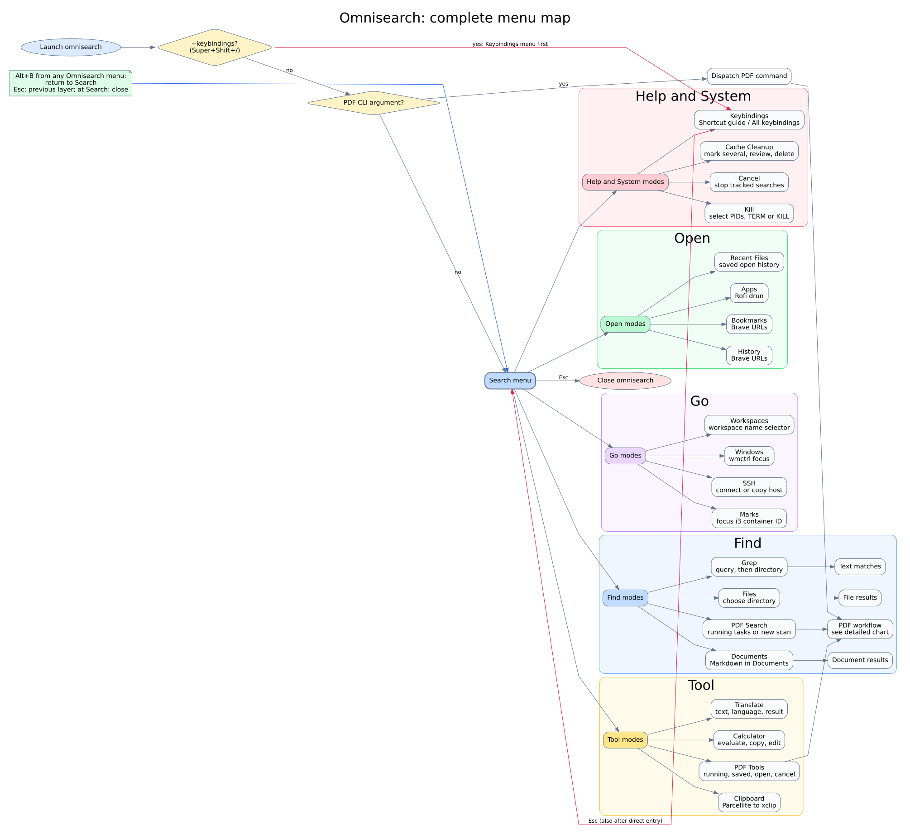
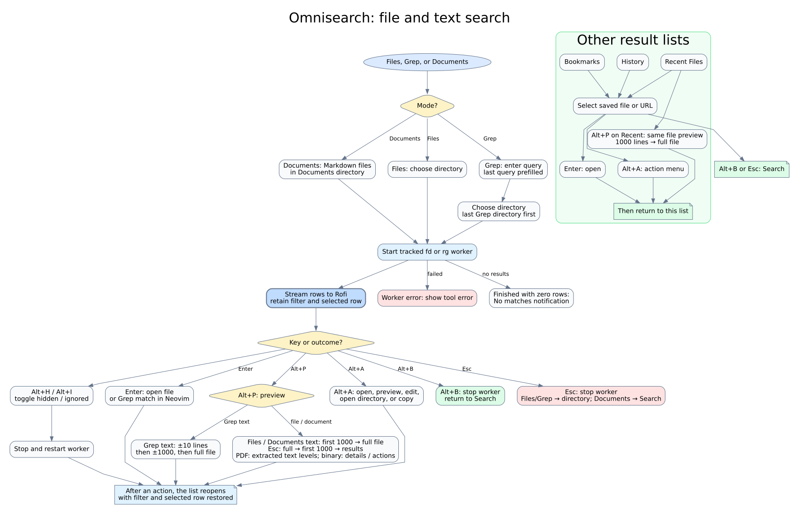
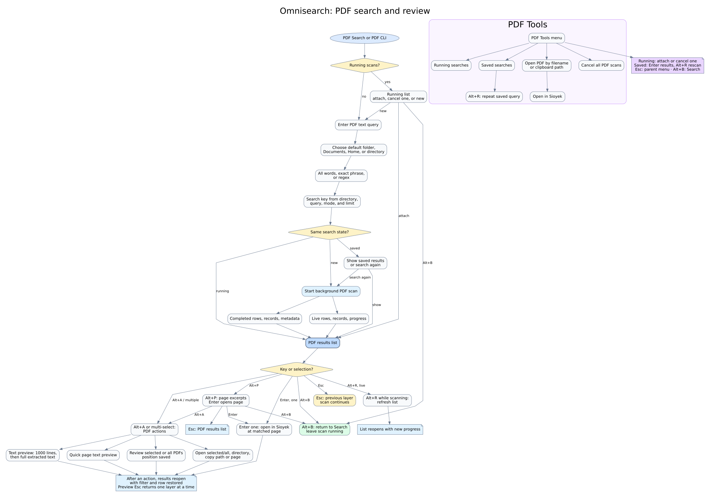

# Omnisearch workflow

This documents the current behavior of `i3_rofi_omnisearch.sh`, `i3_pdf_menu.sh`, and `i3_pdf_search.py`. The SVG diagrams can be opened and zoomed directly:

- [Complete menu map](OMNISEARCH_OVERVIEW.svg)
- [File and text search flow](OMNISEARCH_SEARCH.svg)
- [PDF search flow](OMNISEARCH_PDF.svg)

## 1. Complete menu map

[Editable diagram source](OMNISEARCH_OVERVIEW.dot)

## 2. File and text search

[Editable diagram source](OMNISEARCH_SEARCH.dot)

Files, Grep, and Documents run `fd`/`rg` in a detached worker (`--search-worker`) that writes to `~/.cache/rofi-omnisearch/search/`. Rofi is never open while rows are still streaming in, so a slow search cannot hold the keyboard and pointer grab. A search that finishes within about 1.5 s opens its results directly. A slower one closes Omnisearch, keeps running, and sends a notification when it finishes. Finished searches are pruned automatically: older than 7 days, beyond the newest 10, or past a 200 MiB total (the newest finished search is always kept). Cache Cleanup also lists them, with running ones protected. **Find · Results** lists them: Enter opens their results (a snapshot while still running), and Alt+C cancels one. Closing a results list does not stop its worker. Escape then returns Files and Grep to their directory picker, or Documents to Search. Recent Files stores up to 100 unique opened paths. Grep remembers its last query and directory. A result action returns to its list with the filter and selected row restored. In Files, Documents, and Recent Files, Alt+P opens the first 1000 text lines; Enter expands to the full file, Escape steps back to 1000 lines, and another Escape returns to results. Files with at most 1000 lines have one preview level. PDF files use the same extracted-text preview levels as PDF search; binary files show details and actions. Grep keeps its match-centered ±10, ±1000, and full-file levels.

## 3. PDF search and review

[Editable diagram source](OMNISEARCH_PDF.dot)

PDF searches use a cache key so the same search can be reattached or reopened. Closing a PDF results list does not cancel its scan. Escape returns to the previous setup or task list. The explicit cancel commands stop scans. The PDF Tools menu also exposes saved searches, opening by filename, and cancellation.

### Direct PDF commands

`--keybindings` (Super+Shift+/) shows the Keybindings menu first, then continues to Search. Any other argument goes to the PDF helper before the Search menu is shown. `--pdf-search` offers running tasks or a new search; `--pdf-attach` lists running tasks; `--pdf-view` opens saved searches; `--pdf-open` opens a PDF by name or clipboard path; and `--pdf-cancel` stops scans. The default and directory variants start searches directly, while the `-all` variants wait and open matching PDFs. `--pdf-search-compat` preserves the older caller interface. Alt+B from a PDF menu opens Search even when launched with an argument; Escape at the first screen of a direct PDF command closes that command.

## 4. Remaining menu paths

| Mode | Flow |
| --- | --- |
| Apps | Hand control to Rofi's application launcher (`drun`). |
| Calculator | Enter an expression → evaluate with the built-in Python calculator → copy the result or edit the expression. |
| Translate | Enter text → choose Chinese or English → run `trans` → copy, edit, or translate again; errors return to editing. |
| Clipboard | Read Parcellite history → choose an entry → copy it to the clipboard and primary selection. |
| Windows | Choose a `wmctrl` window → focus it. |
| Workspaces | Choose from the same workspace name list and theme used by the workspace operator, then focus the workspace. |
| Marks | List i3 marks with window titles → focus the selected container ID. |
| SSH | Read non-wildcard hosts from SSH config → choose hosts → connect or copy their names. |
| Keybindings | Choose the Shortcut guide or All keybindings (read-only list generated from the i3 config files). Also opened directly with Super+Shift+/ (`--keybindings`); Escape there continues to Search. |
| Kill | Choose one or more PIDs → select SIGTERM, SIGKILL, or Cancel. |
| Results | List background Files/Grep/Documents searches → open results, or Alt+C to cancel a running one. |
| Cancel | Stop tracked file/text workers and PDF scans; report how many were stopped. |
| Cache Cleanup | Show saved PDF searches, review positions, recent files, remembered inputs, and older cache files. Ctrl+Space marks several entries; Enter reviews the selection; confirm to delete. Running searches stay protected. |

## Navigation and state at a glance

| Screen | Enter | Alt+B (global) | Esc (local) |
| --- | --- | --- | --- |
| Search | Open selected mode | — | Close omnisearch |
| Files / Grep results | Default open action | Return to Search (worker keeps running) | Return to directory picker (worker keeps running) |
| Files / Documents / Recent Files text preview | First 1000 → full file → results | Return to Search | Full file → first 1000 → results |
| Documents, Recent Files, History, Bookmarks | Open selection | Return to Search | Return to Search |
| PDF setup (query → location → match type) | Continue to next step | Return to Search | Return to previous setup step; query returns to Search |
| PDF results and PDF pages | Open PDF or page | Return to Search; scan continues | Return to match type or task list; pages return to results |
| PDF text preview | Expand from 1000 lines to full text | Return to Search | Full text → 1000 lines → action menu |
| Running and saved PDF lists, PDF Tools | Open selected task or tool | Return to Search | Return to parent PDF menu; PDF Tools returns to Search |
| Cache Cleanup | Review selected entries, then confirm deletion | Return to Search | Confirmation → cache list; cache list → Search |
| Calculator and Translate | Evaluate or continue | Return to Search | Return to previous input or selection; first input returns to Search |
| Action dialogs and other selectors | Apply selected action | Return to Search | Return to the list or menu that opened the dialog |

Alt+B works from Omnisearch's menus; Escape at Search closes Omnisearch. Alt+P previews and Alt+A opens actions where shown. Alt+H and Alt+I change the file/text search scope. Ctrl+Left still moves backward one word in menus that use Alt+B. A background PDF scan continues after either navigation key; the explicit Cancel actions stop it.
